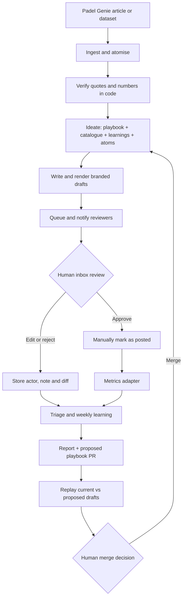

# Padel Genie social intern

A virtual social intern that turns Padel Genie’s reports into branded, evidence-backed social drafts.
Humans review the drafts and approve any proposed changes to the intern’s editorial playbook.

**[Open the live inbox](https://padel-genie-content.vercel.app)** — James and Matthew’s login details are shared privately. Sign-ups are disabled; the app is noindex and database access requires a reviewer session.

## What shipped

Five approved posts, nine 1080×1350 PNGs and captions: [examples](examples/README.md) · [download](examples/selected-posts.zip).
Matthew re-approved the refreshed graphics after the layout fix and **confirmed delivery of all three email types**: new drafts, learning report and replay ready. These are human delivery confirmations, beyond the recorded Resend API acceptances.

The first real learning run used five approvals and one layout rejection. It correctly proposed **no editorial change**: [report](ai/learning-report.md) · [report-only PR #1](https://github.com/thoomkuzhymatthew/padel-genie-content/pull/1). The workflow never merges.



## Pipeline, stage by stage

1. **Ingest:** snapshot a URL or HTML/Markdown/CSV file; retain clean text, tables, publication metadata and hashes.
2. **Atomise and verify:** extract numeric and named narrative facts. Code checks exact quotes and whole numeric tokens. `period_source: "metadata"` may supply the publication period; it never supplies a statistic.
3. **Ideate:** assemble the current playbook, `templates/*/template.json` catalogue, merged learnings and verified atoms; propose 6–8 distinct, ranked ideas.
4. **Write:** use the selected story and template fields, keeping verified figures fixed. Copy has numerical and descriptor checks.
5. **Render:** Playwright turns HTML/CSS into PNGs. Missing fonts, overflow, collisions, inadequate margins or small text fail the render.
6. **Queue:** store content, captions, assets, evidence and model/playbook traces in Supabase; notify opted-in recipients. Existing review decisions are preserved.

**Current limitation:** `npm run pipeline` implements stages 1–2, including verification. Later stages run through the explicit commands below; `queue` loads the selected demo manifest. A single arbitrary URL-to-inbox command is **not complete**, so section 18’s first criterion remains open. The URL-generation box and automatic daily ingest are next steps.

## Run locally

Node 22+ and npm are required. Use the content project’s existing `.env`, or copy `.env.example` if none exists. Never use the Part 1 project. Supply the OpenAI and Supabase credentials locally; Resend needs `RESEND_API_KEY`, `RESEND_FROM` and `INBOX_URL`. Values are never committed.

```sh
npm ci
npx playwright install chromium
npm test
npm run build
npm run dev

npm run pipeline -- --url https://padelgenie.io/blog/uk-passes-3000-padel-courts/
npm run ideate -- --run runs/<run-id>
# After choosing an idea, use a draft JSON matching its template descriptor:
npm run write -- --draft <seed.json> --output <draft.json>
npm run render -- --draft <draft.json>
# Reproduce and queue the selected demo batch:
npm run render:examples -- --reserve
npm run queue
```

`runs/` contains inspectable prompts, candidates, rejections and traces and is ignored by Git. Evidence bundles already used by the examples are in `reports/`. Apply schema changes with `npm run db:migrate` against the project selected by `.env`.

Artwork edits require local rendering: `npm run render -- --post <uuid>`. Commit/push the generated files, wait for Vercel, then run `npm run render:confirm -- --post <uuid>` to verify deployed hashes. Approval is blocked while artwork is stale. Caption-only edits need no re-render.

## Feedback and learning

Every edit/rejection keeps its actor, original note and before/after diff. Classification appears beside the note:

| Feedback | Route |
| --- | --- |
| Post-specific | Apply to that post; re-render changed artwork. |
| Template/layout | Fix template code and check all affected renders; never change the playbook. |
| Recurring editorial | Suggest an evidence-linked playbook change for human review. |
| Data/fact | Flag linked atoms and block approval pending review. |

**Learning → Update intern** dispatches GitHub Actions and shows queued/running/done or failed status. `learn.yml` also runs Mondays at **08:00 UTC**. It reads the period’s real events and explicitly labelled mock metrics, opens a PR, and compares replays before any merge. LOCKED rules are preserved byte for byte. Engagement suggestions need at least 20 posted items per format (`config/learning.json`); mock data never proves real performance. An unchanged playbook uses the same replay control on both sides.

Settings manages recipients and per-type email toggles. Failed emails never fail jobs; retry them with `npm run notify:retry -- <learning-run-uuid>`. Delivery currently reaches Matthew’s Resend account address only; a verified sending domain is needed for James too.

GitHub holds pipeline secrets; Vercel holds only public Supabase browser config and the **server-only** dispatch token. Vercel deploys from GitHub. Today publishing is manual: a future autonomy ladder could allow established formats above 90% approval without edits over 30 posts to earn limited automation with spot checks. New formats and factual concerns still require review.

[Approach and next steps](APPROACH.md) · [AI working files](ai/README.md) · [final section 18 checks](reports/ship-checks.md).
