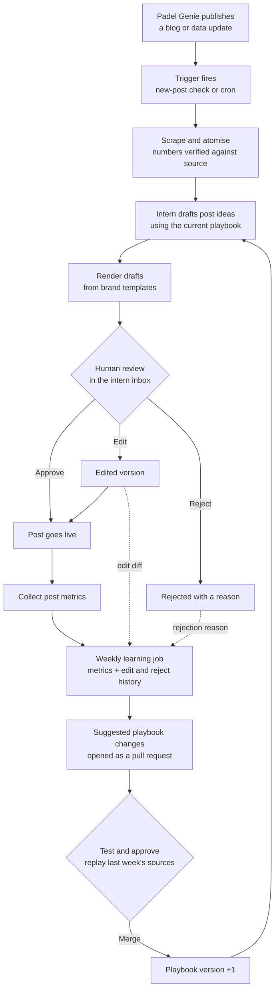

# Padel Genie social intern

Private Solved trial, Part 2. Milestones 2–3 implement ingestion, structured fact extraction, deterministic
verification, the versioned playbook (currently v3), a descriptor-only template catalogue and ideation.
Rendering and the authenticated review inbox are implemented. Learning, Settings and emails remain milestone 6.

## Run locally

Requires Node 22+ and npm. Run `npm ci`, copy `.env.example` to `.env` only if you
do not already have `.env`, and set `OPENAI_API_KEY`. Existing environment variables
take precedence over `.env`. Never put secret keys in `VITE_` variables.

```sh
npm test
npm run build
npm run pipeline -- --url https://padelgenie.io/blog/uk-passes-3000-padel-courts/
npm run pipeline -- --url https://padelgenie.io/blog/august-2026-uk-padel-market-recap/
npm run pipeline -- --file sources/report.md
```

`--ingest-only` saves the source without making an LLM request. To re-extract from
an existing run without requesting the website again:

```sh
npm run pipeline -- --source runs/<run-id>/source.json
```

The pipeline command ends after verification; ideation is a separate explicit review step. The final stages 1–6 command will
be completed in later approved milestones. It does not yet render or queue posts.
`npm run build` checks TypeScript and builds the noindex, authenticated inbox. Only the public Supabase URL and anon key enter the browser bundle.

## Inspect a run

Each ignored `runs/<run-id>/` directory contains:

- `raw.html` / `raw.md` / `raw.csv`: original input snapshot.
- `source.json`: title, source URL, publication date (null when unavailable),
  canonical clean text, tables, figure captions/alt text and content hashes.
- `extract.prompt.md`, `extract.trace.json`: prompt, prompt/input hashes, selected
  and returned model identifiers, response ID and token usage.
- `atoms.candidates.json`: all model candidates before verification.
- `atoms.verified.json`: the only permitted downstream handoff.
- `atoms.rejected.json`: rejected candidates and explicit reasons.
- `verification.json`: totals and verified source-text hash.
- `error.json`: safe failure message when a stage fails.

One request per source page with a clear user agent, bounded input size and a
30-second fetch timeout. Cached re-extraction checks the raw input hash. The LLM
uses the official OpenAI SDK with structured JSON, no response storage, a timeout
and at most two SDK transport retries. Refusals/incomplete outputs are rejected.
Model changes are confined to `config/models.json`; prompts live in `pipeline/prompts/`.

## Verification boundaries

A quote must occur verbatim in the saved canonical text, after ingestion has
normalised HTML spacing. Every numeric value and comparison must appear as a
complete numeric token in that quote; numeric years in quote-based periods are checked too. A value may instead use
`period_source: "metadata"` with its period exactly equal to the publication date.
This exception applies only to the period, never numeric statistics or comparisons.
It is a publication snapshot label, not proof of an event date.
Comma and non-breaking-space thousands separators do not change magnitude.
No substring matches, implicit `k`/million conversions, derived figures or rounded
values are accepted. Numeric claims must declare their numbers in structured fields.
Malformed atoms and duplicate IDs are rejected. Zero verified atoms fails the run.

This proves numeric provenance, not semantic truth: an exact quote can still be
misinterpreted, assigned the wrong unit or lose a qualifier. Human review remains
necessary. Chart numbers available only inside JavaScript or images are omitted,
not guessed. CSV cells are JSON-escaped and pipe-delimited in canonical evidence,
with headers and original cell arrays retained. No dates are fabricated.

## Layout and next milestones

`pipeline/` contains Node stages and pure verification; `config/` contains model
and pipeline settings. `templates/`, `playbook/`, `proposed_templates/`,
`supabase/migrations/`, `reports/`, `examples/` and `ai/` reserve the approved layout.
`web/` is the separate Vite/React root, with generated assets eventually served
from `web/public/outputs/`. Pipeline modules are never imported into browser code.

## Ideation and human review

```sh
npm run ideate -- --run runs/<run-id>
```

The command reverifies the atom handoff, loads `playbook/playbook.md`, discovers
`templates/*/template.json`, and adds `playbook/learnings.md` fresh each run. It
records the playbook version and content hashes for all prompt inputs. The model
sees source metadata and verified atoms, not unchecked article facts. Catalogue
formats are `stat`, `carousel`, `ranked-bars` and `comparison`; template names are
separate identifiers. Descriptors define fields/limits only, with no HTML yet.

Outputs include `ideas.json`, original candidates/rejections, the assembled system
prompt and user input, and `ideate.trace.json`. A deterministic gate checks atom
references, template/format pairs, score bounds and numerical provenance from the
selected atoms' values, comparisons and verified periods. One bounded repair pass
may replace rejected ideas; it cannot bypass verification. Fewer valid ideas are
preferred to unsupported ones. Scores are editorial judgement, not measured engagement. V2 adds forced ranks,
a meaningful score spread, named examples, main-story and product-detail evidence,
and an improvement line. Provisional/projected main stories are rejected.

The latest revised October and August shortlist is in
[the playbook v2 review](reports/playbook-v2/README.md). The original source/atom/prompt
bundles remain in [the milestone 3 baseline](reports/milestone-3/README.md), including confirmation
that October's headline court count now passes. These are proposals awaiting human
review. No copy, template HTML or graphics are generated before that review.

Milestones 4–5 now provide rendered examples, the Supabase queue and authenticated review inbox.

## Intended system



The trial uses manual "mark as posted", not real social publishing. Direct social
posting, per-audience targeting, paid ads, WhatsApp/Slack interfaces, generative
imagery/video and full council-level maps are deliberately out of scope.

## First human steer and narrative evidence

V2 pairs hero numbers with named examples, requires concrete product hold-backs,
merges repeated angles, uses ranked-bars for geographic comparisons, and skips
provisional/projected hero stories. `DECISIONS.md` records the first human steer;
`ai/playbook-v1.md` and `ai/playbook-v2.md` preserve playbook history. The LOCKED
block is unchanged. No engagement results have been invented.

Atom fields now include `kind`, `entities` and `certainty`; new extraction requires
them while legacy runs remain readable. Named number-free facts use `values: []`.
Mixed narrative facts retain numeric quote checks. The extractor uses the stronger
configured model after the mini repeatedly lost critical named evidence. One bounded
correction attempt is saved, then the same verifier runs again. Narrative number
words require lexical quote evidence and do not license implicit digit conversions.

The assistant-curated shortlist retains `ideas.model.json` and a separate
`ideas.curation.json` change log. These merges/tightenings are proposals, not human
approval or a fabricated reviewer event. Rendering waits for the user's choices.
Native inbox preview formats are specified in section 9 for milestone 5 only.

## Milestone 4 style checkpoint

The second human steer requires 6–8 distinct ideas after merging true duplicates.
The user-selected five-post batch is recorded in `reports/milestone-4-plan.md`.
The first stat card established the subsequently approved style. Reproduce it with
`npm run render -- --draft reports/milestone-4/first-stat.draft.json`.
See `reports/milestone-4/README.md` for output paths and verification details.

## Milestone 4 outputs

The five selected posts are rendered in the approved style, plus reserve A2.
[View the examples](examples/README.md) or [download PNGs and captions](examples/selected-posts.zip).
`npm run render:examples -- --reserve` reproduces the selected batch and reserve
without new LLM calls. `npm run write -- --draft <seed.json> --output <new.json>`
uses the configured copy model for editorial text while preserving numerical fields.
The remaining three templates now have HTML/CSS, including all published regions
with a GB-average line, paired year-on-year metrics and a five-slide carousel.
See `reports/milestone-4/README.md` for provenance, commands and validation.

## Milestone 5 inbox

Production: https://padel-genie-content.vercel.app

Email/password login is restricted to the existing James and Matthew reviewers. Public
sign-ups are disabled. RLS requires an authenticated reviewer; writes go through an
atomic RPC with actor attribution, version checks and server-generated diffs.
The six rendered posts, including reserve A2, are queued as proposed with full traces
and their originating playbook version. Queueing again preserves review decisions.

```sh
npm run db:migrate
npm run queue
npm run dev
```

Commands derive the content project from `.env`; never point them at the Part 1
project. The browser uses only the public URL/anon key. Admin keys and test login
credentials stay local. Vercel builds and deploys from GitHub.

The inbox supports Proposed, Approved, Posted and Rejected tabs; inline caption and
artwork wording edits with a note; reason chips/free text for rejection; and named,
timestamped action history. Verified figures and source lines are fixed. Native
previews include 4:5 images and swipeable carousels; the 9:16 looping video viewer
is ready for future clips. Mark as posted records a manual action, not publishing.

Artwork edits hide the outdated preview and block approval until re-rendered:

```sh
npm run render -- --post <uuid>
# Commit/push the generated web/public/outputs/inbox files; wait for Vercel.
npm run render:confirm -- --post <uuid>
```

Playwright runs locally. Confirmation verifies deployed file hashes at `INBOX_URL`
before marking the artwork current. Caption-only changes need no re-render.

See [milestone 5 verification](reports/milestone-5.md) for live checks. Verification
uses only the configured test account and temporary posts, removed afterwards.

## Next inbox improvement

Add a “Request changes” action for mobile: a short reviewer note prompts a revised
draft, with the note and before/after diff stored as an edit event and the result
returned for approval. Deferred to keep milestone 6 focused on the verified learning loop.

## Milestone 6: learning and notifications

`npm run learn` runs weekly (Monday 08:00 UTC) and manually through GitHub Actions.
The authenticated **Learning → Update intern** button dispatches that workflow via
`/api/learn`. The server verifies the reviewer session; `GITHUB_DISPATCH_TOKEN`
never enters the browser. The inbox shows queued, running, done or failed state,
the persisted report, exact suggested changes, PR link and source replay comparison.
There is no merge button or auto-merge path.

The job loads the last seven days of real edit/rejection events, preserving exact
notes and diffs. Findings route to post-specific, template/layout, recurring
editorial or data/fact. Reviewer text edits are preserved; note-only local wording
requests are applied only to that post and re-rendered. Layout findings require a
template-code fix and passing render checks for all affected posts; they never
become editorial playbook suggestions. Data/fact findings flag linked atoms and
block approval until review. Each note's classification and resolution appear in
the inbox history. The first divider-overlap issue is fixed and resolved.

Suggestions must cite real recurring-editorial event IDs and replace exact text
above the LOCKED marker. A code guard preserves every byte from that marker
onwards. With no justified editorial change, the proposal is a report-only PR.
Replay re-ideates both source snapshots and rewrites one selected story per source,
keeping the evidence and template fixed. If the playbook is unchanged, both columns
show the same generated control; otherwise each side regenerates independently.
Proposals affect future runs only after a human merges their PR.

`pipeline/metrics/adapter.ts` defines the metrics interface. The deterministic mock
adapter writes **mock** rows only for posted items; carousel performance is varied
for demonstration. No engagement recommendation is eligible below 20 posted items
per format (configured in `config/learning.json`). Even eligible mock rows are demonstration
signals, not live evidence. Instagram and LinkedIn adapters remain explicit stubs:
they need authorised platform access/app review or a CSV import.

Settings manages notification recipients and three independent toggles. Resend
sends new-draft, learning-report and replay-ready emails with links into the inbox.
Email delivery has its own deduplicated log and never determines job success.
For this trial only Matthew's Resend account address can receive delivery; verify
a sending domain before notifying James. API acceptance is recorded separately
from inbox delivery; no claim of recipient-open tracking is made.

Runtime configuration (values remain private):

- Vercel: public `VITE_SUPABASE_URL`, `VITE_SUPABASE_ANON_KEY`; server-only
  `GITHUB_DISPATCH_TOKEN` with repository Actions read/write permission.
- Actions: `SUPABASE_URL`, `SUPABASE_SECRET_KEY`, `OPENAI_API_KEY`,
  `RESEND_API_KEY`, `RESEND_FROM`; GitHub's job token has contents/PR write
  permission and the repo allows Actions to create pull requests.
- Local `.env`: the same pipeline credentials, `INBOX_URL`, plus test-account
  credentials for verification. Never add test credentials to Actions or Vercel.

The existing GitHub/Vercel connection deploys replay assets committed by the job.
The job checks deployed hashes before marking replay ready. All DB additions use
reviewer-only RLS; only service jobs mutate reports, metrics and classifications.
The daily URL-ingestion workflow and a URL-generation box remain deferred stretch.

Autonomy is a future policy, not implemented publishing: a format could earn
limited automatic posting after >90% approval without edits across 30 posts,
with spot checks. New formats, factual flags and locked-rule changes always need
human review. Today every draft and every playbook proposal needs human sign-off.

To retry failed learning/replay emails without regenerating the report, use
`npm run notify:retry -- <learning-run-uuid>`, or dispatch `learn.yml` with that
`learning_run_id` and `notifications_only: true`. Sent messages are skipped.

The first verified run uses five real approvals and one layout rejection, proposes
no editorial playbook change, and opens [report-only PR #1](https://github.com/thoomkuzhymatthew/padel-genie-content/pull/1).
See [live verification evidence](reports/milestone-6.md) and the Learning tab.
