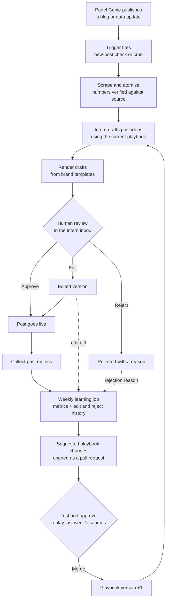

# Padel Genie social intern

Private Solved trial, Part 2. Milestones 2–3 implement ingestion, structured fact extraction, deterministic
verification, the v1 playbook, a descriptor-only template catalogue and ideation.
The review inbox, rendering and learning loop are later milestones.

## Run locally

Requires Node 22+ and npm. Run `npm ci`, copy `.env.example` to `.env` only if you
do not already have `.env`, and set `OPENAI_API_KEY`. Existing environment variables
take precedence over `.env`. Never put secret keys in `VITE_` variables.

```sh
npm test
npm run build
npm run pipeline -- --url https://padelgenie.io/blog/uk-passes-3000-padel-courts/
npm run pipeline -- --url https://padelgenie.io/blog/august-2026-uk-padel-market-recap/
npm run pipeline -- --file sources/report.md
```

`--ingest-only` saves the source without making an LLM request. To re-extract from
an existing run without requesting the website again:

```sh
npm run pipeline -- --source runs/<run-id>/source.json
```

The pipeline command ends after verification; ideation is a separate explicit review step. The final stages 1–6 command will
be completed in later approved milestones. It does not yet render or queue posts.
`npm run build` checks TypeScript and builds a minimal, noindex web shell; it is
not the authenticated inbox and exposes no source data or credentials.

## Inspect a run

Each ignored `runs/<run-id>/` directory contains:

- `raw.html` / `raw.md` / `raw.csv`: original input snapshot.
- `source.json`: title, source URL, publication date (null when unavailable),
  canonical clean text, tables, figure captions/alt text and content hashes.
- `extract.prompt.md`, `extract.trace.json`: prompt, prompt/input hashes, selected
  and returned model identifiers, response ID and token usage.
- `atoms.candidates.json`: all model candidates before verification.
- `atoms.verified.json`: the only permitted downstream handoff.
- `atoms.rejected.json`: rejected candidates and explicit reasons.
- `verification.json`: totals and verified source-text hash.
- `error.json`: safe failure message when a stage fails.

One request per source page with a clear user agent, bounded input size and a
30-second fetch timeout. Cached re-extraction checks the raw input hash. The LLM
uses the official OpenAI SDK with structured JSON, no response storage, a timeout
and at most two SDK transport retries. Refusals/incomplete outputs are rejected.
Model changes are confined to `config/models.json`; prompts live in `pipeline/prompts/`.

## Verification boundaries

A quote must occur verbatim in the saved canonical text, after ingestion has
normalised HTML spacing. Every numeric value and comparison must appear as a
complete numeric token in that quote; numeric years in quote-based periods are checked too. A value may instead use
`period_source: "metadata"` with its period exactly equal to the publication date.
This exception applies only to the period, never numeric statistics or comparisons.
It is a publication snapshot label, not proof of an event date.
Comma and non-breaking-space thousands separators do not change magnitude.
No substring matches, implicit `k`/million conversions, derived figures or rounded
values are accepted. Numeric claims must declare their numbers in structured fields.
Malformed atoms and duplicate IDs are rejected. Zero verified atoms fails the run.

This proves numeric provenance, not semantic truth: an exact quote can still be
misinterpreted, assigned the wrong unit or lose a qualifier. Human review remains
necessary. Chart numbers available only inside JavaScript or images are omitted,
not guessed. CSV cells are JSON-escaped and pipe-delimited in canonical evidence,
with headers and original cell arrays retained. No dates are fabricated.

## Layout and next milestones

`pipeline/` contains Node stages and pure verification; `config/` contains model
and pipeline settings. `templates/`, `playbook/`, `proposed_templates/`,
`supabase/migrations/`, `reports/`, `examples/` and `ai/` reserve the approved layout.
`web/` is the separate Vite/React root, with generated assets eventually served
from `web/public/outputs/`. Pipeline modules are never imported into browser code.

## Ideation and human review

```sh
npm run ideate -- --run runs/<run-id>
```

The command reverifies the atom handoff, loads `playbook/playbook.md`, discovers
`templates/*/template.json`, and adds `playbook/learnings.md` fresh each run. It
records the playbook version and content hashes for all prompt inputs. The model
sees source metadata and verified atoms, not unchecked article facts. Catalogue
formats are `stat`, `carousel`, `ranked-bars` and `comparison`; template names are
separate identifiers. Descriptors define fields/limits only, with no HTML yet.

Outputs include `ideas.json`, original candidates/rejections, the assembled system
prompt and user input, and `ideate.trace.json`. A deterministic gate checks atom
references, template/format pairs, score bounds and numerical provenance from the
selected atoms' values, comparisons and verified periods. One bounded repair pass
may replace rejected ideas; it cannot bypass verification. Fewer valid ideas are
preferred to unsupported ones. Scores are editorial judgement, not measured engagement.

The final October and August ideas and their complete source/atom/prompt bundles
are in [the milestone 3 review](reports/milestone-3/README.md), including confirmation
that October's headline court count now passes. These are proposals awaiting human
review. No copy, template HTML or graphics are generated before that review.

Next: select ideas, then milestone 4's copy and rendering. Supabase schema, RLS and
the login-protected inbox remain milestone 5. No database changes have been made.

## Intended system



The trial uses manual "mark as posted", not real social publishing. Direct social
posting, per-audience targeting, paid ads, WhatsApp/Slack interfaces, generative
imagery/video and full council-level maps are deliberately out of scope.
