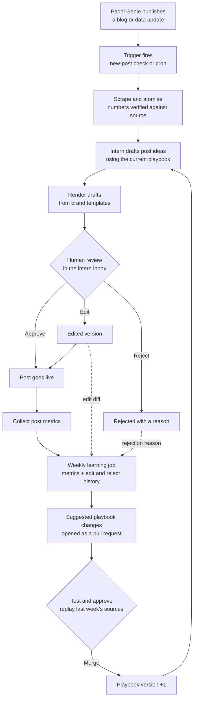

# AGENTS.md — Padel Genie Virtual Social Media Intern (Solved trial, Part 2)

Read this whole file before writing any code. It is the source of truth for this project.

---

## 1. Context

This is a paid trial project for **Solved** (solved.studio), a London product studio. Solved runs **Padel Genie** (padelgenie.io), a UK padel market-intelligence platform that publishes data-led blog posts, such as a monthly "Court Report", and a free live map.

The brief: Padel Genie wants to release far more content from its data, automated and at scale. Build a pipeline that takes any article or dataset like theirs and turns it into images or videos for social media, without someone hand-making every post. They want:

- a working prototype and a few real examples I'd be happy to post
- a short note on the approach: what makes good and bad content, creativity, tools, and how it runs at scale
- the AI working files: prompts, AGENTS.md, transcripts

They are judging resourcefulness, shipping, AI fluency, product and commercial sense, and taste.

**Time budget: about 4 hours.** A working loop with a few excellent outputs beats a big unfinished system. Core milestones come first; stretch items only if ahead.

**Confidential:** don't publish the brief or the work anywhere public beyond what's needed to deliver it (the repo can be private; the live review page should not be indexed).

---

## 2. The idea in one line

**A virtual social media intern for the padel ecosystem.** It reads every new Padel Genie post, drafts social content in Padel Genie's brand, asks a human to approve, edit or reject, and improves its own playbook from that feedback and from post performance, with human sign-off on every change.

We build for the **padel ecosystem** as a whole (operators, players, investors, suppliers, curious newcomers), not for one buyer persona. Audience targeting is a documented next step, not part of this build.

Key insight to preserve throughout: **human edits and rejections are the richest learning signal.** Engagement data needs a large number of posts before it means anything; every edit is an explicit preference from day one.

---

## 3. How to work with me

- **Plan before building.** For each milestone, write a short plan (5–10 lines) and wait for my approval.
- **Report back briefly.** End every task with at most 4 lines: what changed, anything needing my decision, risks or loose ends.
- **Log assumptions** in `ASSUMPTIONS.md` and **decisions** in `DECISIONS.md`, one line each with a reason.
- Small commits with clear messages.
- Never commit secrets. LLM API keys and Supabase secret keys are server-side only and never prefixed `VITE_`.

---

## 4. System diagram



Include this diagram in the README.

---

## 5. Stack

- **Language:** TypeScript / Node throughout (pipeline scripts, rendering and the web inbox).
- **Pipeline:** Node scripts in `pipeline/`, runnable locally and from GitHub Actions.
- **LLM calls:** direct HTTP or official SDK calls, no LangChain. One helper, `pipeline/llm.ts`, reads `config/models.json` and routes each stage to its model. Use structured JSON output wherever a stage returns data.
- **Rendering:** HTML/CSS templates rendered to PNG with Playwright. One video template with Remotion (stretch).
- **Inbox web app:** Vite + React + TypeScript + Tailwind, deployed on Vercel.
- **Database:** Supabase (Postgres, RLS, RPC functions). Generated images are files in the repo (served by the web app), with only their paths in the database. No Supabase Storage.
- **Scheduling:** GitHub Actions cron workflows.

### Model config (`config/models.json`)

```json
{
  "extract":  { "provider": "openai", "model": "<mid-tier model>", "notes": "accuracy, JSON output" },
  "ideate":   { "provider": "openai", "model": "<strong model>",   "notes": "taste and creativity" },
  "copy":     { "provider": "openai", "model": "<strong model>",   "notes": "hooks and captions" },
  "learn":    { "provider": "openai", "model": "<strong model>",   "notes": "pattern mining, playbook diffs" }
}
```

Provider and model names are placeholders I'll confirm. Switching a stage's model must be a config change only.

---

## 6. Pipeline stages

Each stage reads and writes JSON in `runs/<run-id>/`, so every step is inspectable.

1. **Ingest** (`pipeline/ingest.ts`): input is a URL or a local file (HTML, Markdown or CSV). Output `source.json`: title, URL, date, clean text, and any tables or figures extracted.
2. **Atomise** (`pipeline/atomise.ts`, model `extract`): turn the source into an array of facts:
   ```json
   { "id": "a12", "claim": "Conversions from industrial, warehouse and retail units rose sharply",
     "values": [{ "value": 151, "unit": "applications", "compare": 50, "period": "12 months to Aug 2026" }],
     "place": "UK", "source_quote": "<exact sentence from the source>" }
   ```
   **Verifier (code, not LLM):** every number in `values` must appear in `source_quote`, and `source_quote` must appear verbatim in the source text. Reject failing atoms and log why.
3. **Ideate** (`pipeline/ideate.ts`, model `ideate`): with the assembled system prompt (Section 7), propose about 8 post ideas, each:
   ```json
   { "id": "i3", "format": "carousel", "template": "carousel-basic",
     "story": "Padel is moving into Britain's empty buildings",
     "atoms": ["a12", "a13"], "hold_back": "47 big approvals with addresses are in Padel Genie",
     "why_it_works": "Surprising, visual, proves unique data", "score": 8.5 }
   ```
   Ideas may only use verified atoms.
4. **Write** (`pipeline/write.ts`, model `copy`): for the top ideas, write slide or card text and a caption, matching the chosen template's fields.
5. **Render** (`pipeline/render.ts`): fill the template with the written content and verified numbers, render PNGs to `web/public/outputs/<run-id>/`.
6. **Queue**: insert each rendered draft into Supabase as a `proposed` post with its full trace (source, atoms, idea, prompt version, models, template).

`npm run pipeline -- --url <blog-url>` runs stages 1–6 end to end.

---

## 7. The playbook and dynamic prompt

The intern's behaviour lives in **`playbook/playbook.md`**, a versioned document, not code. Every run builds the system prompt fresh from:

1. `playbook/playbook.md` (current version)
2. **The template catalogue**, generated automatically from `templates/*/template.json` (name, purpose, fields, limits). Adding a template folder makes it available to the intern with no code change.
3. **Latest learnings**: the most recent merged summary from the learning loop (`playbook/learnings.md`).
4. The source and verified atoms for this run.

Record the playbook version (git commit hash or version number in the file) on every post.

The intern may also **propose a new template** when nothing fits: it writes `proposed_templates/<name>/` with HTML, CSS and `template.json`, which only enters `templates/` after I approve it.

### First draft of `playbook/playbook.md`

```markdown
# Padel Genie social intern — playbook v1

## Who you are
You are Padel Genie's social media super-intern. Padel Genie publishes data and analysis
on the UK padel market: the live map of every venue and planning application, the monthly
Court Report, and club occupancy and pricing. Your job is to turn each new source into
social posts the padel ecosystem wants to read and share: operators, players, investors,
suppliers and people curious about padel.

## What good looks like
Every post follows the pattern the blog itself uses:
1. Give away the story. One clear, surprising insight.
2. Prove the data is unique. Named places, live numbers, things only Padel Genie knows.
3. Hold back the detail. Point to what's in Padel Genie for anyone who wants to act on it.

Good: one idea per post; one hero number per card; local and named where possible;
contrarian when the data supports it; plain, confident British English.

Bad: several stats crammed into one graphic; vague claims; hype words ("game-changer",
"explosive"); emoji spam; giving away everything; anything that reads like an ad.

## Example ideas (for inspiration, not a fixed list)
- A map of where padel is growing or underserved.
- "This week (or month) in padel" carousel from the latest figures.
- A single striking stat card.
- A before-and-after comparison (last year vs this year, one catchment vs another).
- A short motion piece where a number counts up to its reveal.

## Voice
Dry, sharp and data-led, like a knowledgeable friend in the industry. Short sentences.
No exclamation marks unless the number really earns one.

## Output
Return JSON matching the schema you are given. Explain in one line why each idea works.

<!-- LOCKED: the learning loop must never edit anything below this line -->
## Hard rules
- Only use facts and numbers from the verified atoms you are given. Never invent or round
  in a way that changes meaning.
- Every graphic carries a source and date line: "Source: Padel Genie, <month year>".
- Stay within Padel Genie's brand colours and fonts; never use AI-generated imagery.
- Never name or criticise individual businesses negatively.
- If a source doesn't support a strong post, propose fewer ideas rather than weak ones.
```

---

## 8. Templates and brand

Brand tokens (from padelgenie.io):

```
--pg-green:      #0d3d2c
--pg-terracotta: #a9542f
--pg-cream:      #f5f6f3
--pg-ink:        #0a160f
Headings: Bricolage Grotesque.  Body: Inter.
```

Every template: 1080×1350 portrait (works on LinkedIn and Instagram), Padel Genie wordmark, source and date line, generous margins, high contrast, one hero element. Build all components from scratch; don't copy Padel Genie's site code.

Each template lives in `templates/<name>/` with `template.html`, `style.css` and `template.json` (purpose, fields, max characters per field, number of slides).

**Core set:**
1. `stat-card`: one huge number, one line of context, an optional comparison.
2. `carousel-basic`: hook slide, 3–5 content slides (stat, short list or simple bar chart), closing "hold back" slide pointing to Padel Genie.
3. `ranked-bars`: top 5 items as horizontal bars, with an optional average line.
4. `comparison`: two things side by side (before/after, or place vs place).

**Stretch:**
5. `uk-map`: UK regions shaded by a value (e.g. courts per 100,000), using free ONS region boundary GeoJSON. Use only figures present in the source; note in the README that full council-level maps need Padel Genie's dataset.
6. `video-countup` (Remotion, 1080×1920, 10–15 s): hook text, number counts up, supporting line, call to action. Built from a carousel's content.

No generative AI images or video anywhere.

---

## 9. The intern inbox (web app)

A small, polished web app where the intern "messages" the reviewer. It should feel like a chat with a sharp intern, not an admin panel.

- **Feed:** each draft appears as a message from the intern: "I've read the August Court Report. Here's a carousel on padel moving into empty buildings. Why I think it works: …", with the rendered images (swipeable for carousels) and the caption.
- **Actions per draft:**
  - **Approve**
  - **Edit:** edit the caption or slide text inline, and/or write a note ("punchier hook", "lead with the Homebase example"). Store both the before/after diff and the note.
  - **Reject:** with a required one-line reason (quick-pick chips like "Too dense", "Not interesting", "Off brand", "Wrong angle", plus free text).
- **Status tabs:** Proposed, Approved, Posted, Rejected.
- **"Mark as posted"** on approved items (real social posting is out of scope).
- **Learning tab:** the latest learning report and the suggested playbook diff, with a link to the pull request.
- **Settings page:** a list of notification recipients (add or remove email addresses) with on/off toggles per email type for each recipient (Section 13a).
- Mobile-friendly, in Padel Genie's brand (same tokens and fonts as the templates).
- Show who acted on each draft ("Edited by James · 14:02").

### Access: internal only, two named reviewers

- Use **Supabase Auth with email and password**. I'll create **two accounts in the Supabase dashboard, one for James and one for Matthew**, each with their own password, and **disable public sign-ups**.
- Keep a small `reviewers` table (`user_id`, `display_name`) so the inbox can show names.
- The inbox opens on a branded login screen. No sign-up link.
- **All reads and writes require an authenticated session**, enforced server-side with RLS (`authenticated` role only, no `anon` access to any table).
- The page sets `noindex`. Login details are shared privately, never in the repo.

**Stretch:** browser notifications when new drafts arrive.

---

## 10. Database (Supabase)

- **posts:** `id`, `run_id`, `source_url`, `source_title`, `format`, `template`, `story`, `content` (jsonb), `caption`, `asset_paths` (text[]), `trace` (jsonb: atoms, idea, models, prompt text hash), `playbook_version`, `status` (`proposed` | `approved` | `posted` | `rejected`), `created_at`.
- **post_events:** `id`, `post_id`, `actor_id` (the reviewer's user id), `type` (`approve` | `edit` | `reject` | `posted`), `before` (jsonb), `after` (jsonb), `note`, `reason_tags` (text[]), `created_at`.
- **post_metrics:** `post_id`, `date`, `platform`, `impressions`, `likes`, `comments`, `shares`, `saves`, `clicks`.
- **reviewers:** `user_id` (references the auth user), `display_name`.
- **notification_recipients:** `id`, `email`, `notify_new_drafts` (bool), `notify_learning_report` (bool), `notify_replay_ready` (bool), `added_by` (user id), `created_at`.

RLS on every table: only the `authenticated` role can read or write, and `anon` has no access. The pipeline and learning jobs write with the Supabase secret key from the server side only (local env or GitHub Actions secrets).

---

## 11. Metrics adapters

- Interface in `pipeline/metrics/adapter.ts`: `fetchMetrics(posts, since) → MetricRow[]`.
- **`mock` adapter (built):** generates plausible sample metrics for posted items, deterministic per post id, with some formats deliberately performing better so the learning loop has something to find.
- **`instagram` and `linkedin` adapters (stubbed):** documented interfaces with TODOs. Instagram Graph API needs a business account and app review; LinkedIn analytics needs partner approval or CSV import. Note both in the README.

---

## 12. The learning loop

`npm run learn` (weekly in GitHub Actions):

1. Pull metrics via the configured adapter into `post_metrics`.
2. Load the period's posts, events (edits with diffs and notes, rejections with reasons) and metrics.
3. **Guardrails:**
   - Edit and rejection patterns can drive suggestions from the start (explicit preferences, small N is fine).
   - Engagement-based suggestions only once a format or pattern has at least 20 posted items (configurable); below that, report "not enough data yet".
4. Model `learn` writes `reports/learning-<date>.md`: what got approved, edited and rejected and why, what performed, and **specific suggested playbook edits with the evidence for each**.
5. Apply the suggestions to a copy of the playbook, **never touching the LOCKED section**, and open a **GitHub pull request** with the diff and the report.
6. **Replay test** (`npm run replay`): rerun the last period's sources with the current and proposed playbooks and output both sets of drafts side by side in the inbox's Learning tab for comparison before merging.

For the trial, run the loop once on real edits I make in the inbox plus mock metrics, and include the resulting report and PR.

### Autonomy ladder (document, don't build)

Describe in the README how the intern earns autonomy: once a format's approval rate without edits stays above a threshold (e.g. 90% over 30 posts), its drafts can auto-publish with periodic spot checks, while new formats and anything touching the locked rules always need approval.

---

## 13. Triggers and scheduling

- **`ingest.yml`** (daily): check the Padel Genie blog listing for posts not yet processed (store processed URLs), run the pipeline for new ones.
- **`learn.yml`** (weekly): run the learning loop and open the PR.
- **Manual:** `workflow_dispatch` on both, and `npm run pipeline -- --url <url>` locally.

Be polite to padelgenie.io: one request per page, a clear user agent, no aggressive crawling.

---

## 13a. Email notifications

The intern emails the reviewer when it needs them. Use **Resend**, sent server-side only from the pipeline and learning jobs (API key in env or GitHub Actions secrets, never in the frontend).

Send each email to every address in `notification_recipients` that has that type switched on. Three email types:

1. **New drafts ready:** "I've read <source title> and drafted N posts." Thumbnails of the top drafts and a "Review drafts" button.
2. **Weekly learning report:** "Here's what I learned this week and how I'd change my playbook." Two or three key findings, plus links to the report and the pull request.
3. **Replay results ready:** "Here's last week's content rewritten with the proposed playbook. Approve the merge?" Link to the side-by-side comparison in the Learning tab.

Rules:
- Short, in the intern's voice, in Padel Genie's brand. Plain HTML email that renders well on phones.
- Every link deep-links into the inbox (login required).
- Without a verified sending domain, Resend only delivers to the Resend account's own email. Sending to James as well needs a verified domain; if none is available, deliver to my address only and note the limitation in `ASSUMPTIONS.md`.
- If sending fails, log it and carry on. A failed email must never fail the pipeline.

---

## 14. Sources for the demo

Run the pipeline on both, to show it generalises:

- October post: https://padelgenie.io/blog/uk-passes-3000-padel-courts/
- August Court Report: `<URL to be added>` (if unavailable, I'll provide the text as a local file in `sources/`)

---

## 15. Out of scope (document in README as deliberate omissions)

- Posting directly to social platforms
- Per-audience targeting and paid ads (next step: audience-aware playbook sections and geo-targeted local ads)
- WhatsApp or Slack intern (next step: the WhatsApp Business API needs a verified business number and message templates; the inbox's data model already supports it)
- Generative AI imagery or video
- Full council-level maps (need Padel Genie's dataset)

---

## 16. Milestones

1. **Setup (me):** repo, Supabase project (James and Matthew accounts created, public sign-ups disabled), Vercel project, env vars, LLM API key, Resend API key.
2. **Ingest, atomise and verify** on both sources, with tests for the verifier.
3. **Playbook, prompt assembly and ideate:** show me the 8 ideas per source before going further.
4. **Templates and render:** core 4 templates, rendered from real content.
5. **Supabase and inbox:** schema, RLS, login screen, inbox with approve/edit/reject, deployed.
6. **Learning loop and emails:** mock metrics, report, PR, replay comparison, then the three email notifications and the Settings page.
7. **Stretch:** `uk-map`, `video-countup`, GitHub Actions schedules, browser notifications.

**If behind schedule at around hour 3**, cut in this order and document each cut as a next step: GitHub Actions schedules → replay test → automatic PR (write the suggested playbook diff to a file instead) → emails. Never cut the verifier, the inbox actions or the quality of the example posts.
8. **Ship:** README, APPROACH.md, examples, AI working files.

---

## 17. Deliverables

- **Live inbox URL** (login details shared privately in the submission email).
- **Repo** (GitHub link or zip).
- **`examples/`:** 3–5 finished posts I'd happily publish, as PNGs (and MP4 if built).
- **`APPROACH.md`** (one page): what I'd make and why; what makes good vs bad content; tools and model choices; how it runs at scale; the learning loop; what I'd build next.
- **`README.md`** with the system diagram, setup and usage.
- **`ai/`:** AGENTS.md, the playbook history, and Codex session transcripts.

## 18. Definition of done

- One command turns a Padel Genie URL into rendered, on-brand drafts in the inbox.
- No unverified number can reach a rendered graphic.
- The inbox is unreachable without logging in, and no table is readable with the public key alone.
- Approve, edit and reject work from a phone, and every action is stored with its diff or reason.
- A new pipeline run sends a "new drafts ready" email that links straight into the inbox.
- The learning loop produces a real report and a playbook PR from inbox feedback plus mock metrics, without touching locked rules.
- At least 3 example posts that look genuinely publishable.